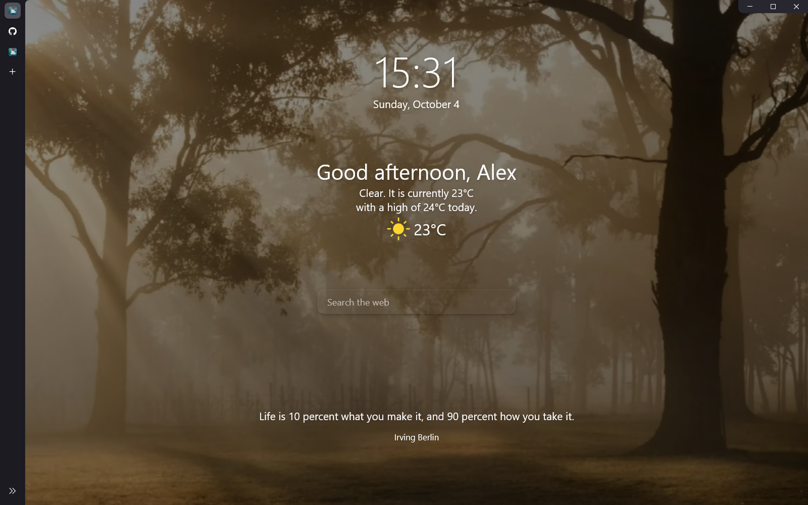
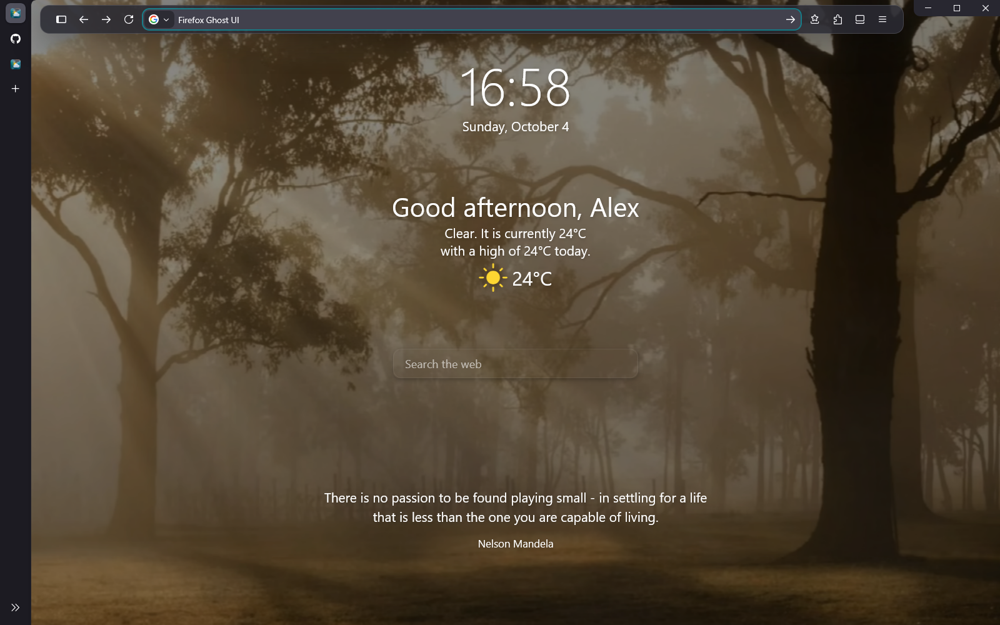
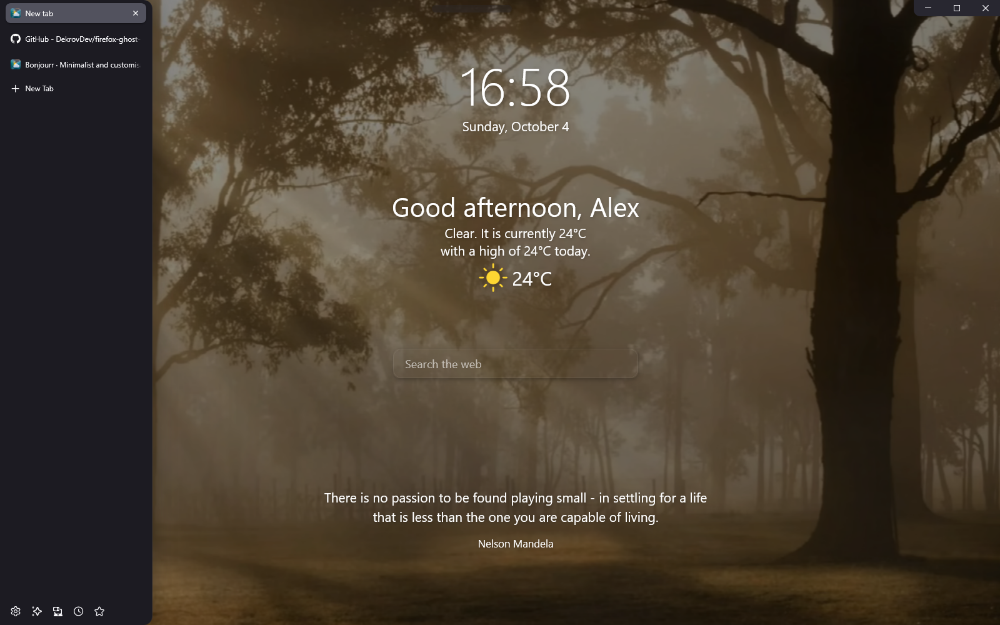

# Firefox Ghost UI

A floating Firefox toolbar, hover sidebar and adaptive Windows window grips that keep browser controls within reach while leaving more room for the page.

[Download Latest](https://github.com/DekrovDev/firefox-ghost-ui/releases/latest) | [Documentation](docs/technical.md) | [Report Issue](https://github.com/DekrovDev/firefox-ghost-ui/issues)

**A clean new tab.** The toolbar stays hidden while the central Bonjourr search remains available.

See the floating toolbar and expanded sidebar

**Search when you need it.** Press Ctrl+L to open the native address bar immediately.

**Tabs within reach.** Hover over the sidebar to reveal tab titles without shifting the page or opening the toolbar.

Screenshots use an English demo profile with optional [Bonjourr](https://addons.mozilla.org/firefox/addon/bonjourr-startpage/). Its wallpaper, clock, weather and central search are configured separately; the installer preserves your own settings and language. The [background video](https://pixabay.com/videos/id-83880/) comes from Bonjourr's media library and is not bundled with the installer.

## Features

- Floating navigation toolbar: hover at the top edge or pill, or press **Ctrl+L** to search immediately.
- Native vertical tabs in a sidebar that expands over the page without shifting it.
- A separate download island with progress, completion feedback and Firefox's file list.
- Native window buttons revealed by hovering at the top-right corner.
- External window grips for native dragging; **Ctrl+Alt+F9** starts keyboard movement and **Ctrl+Alt+F10** recovers an offscreen window.
- Controls hide in F11/video fullscreen; reduced motion is supported. Exit fullscreen before window recovery.
- Optional Bonjourr styling and animations, with colors supplied by Adaptive Tab Bar Colour.

## Quick install

**Windows only as verified.** Normal installation needs no administrator access, Git, Python or extra PowerShell modules. See [tested versions and limits](docs/technical.md#verification-scope).

1. Install desktop Firefox and open it once to create a profile.
2. [Download the latest Windows ZIP](https://github.com/DekrovDev/firefox-ghost-ui/releases/latest) and **extract the entire archive**.
3. Double-click **Install.cmd** and choose your Firefox profile if asked.
4. Close Firefox normally when requested, press Enter in the installer, then start Firefox again.

The installer saves backups and preserves existing settings. It installs a per-user Windows companion that starts at sign-in, supplies grips and recovery shortcuts, and offers pause, move, return and exit in its tray menu. It does not read browser content or inject code into pages. [Companion setup and limitations](docs/adaptive-handles.md).

## Update and uninstall

To update, extract the newer release, close Firefox and run **Install.cmd**. The original pre-install backup is preserved; managed configuration blocks are not duplicated.

To uninstall, close Firefox and run **Uninstall.cmd**. Original managed files and preference values are restored while other current preferences are retained; backups remain in the profile's `chrome/ghost-ui-backups/` folder. Managed file edits block update/uninstall: save your edits or restore the managed file first. [Profile safety](docs/technical.md#profile-safety).

## Extensions and the complete look

Extensions are **installed separately** from official sources and are not bundled:

- [Bonjourr](https://addons.mozilla.org/firefox/addon/bonjourr-startpage/) provides the screenshot's wallpaper, clock, weather and central search. Configure it yourself, then close Firefox and rerun **Install.cmd** for Ghost UI animations. Existing settings are preserved.
- [Adaptive Tab Bar Colour](https://addons.mozilla.org/firefox/addon/adaptive-tab-bar-colour/) matches browser colors to the website.
- [Ambient Light for YouTube](https://addons.mozilla.org/firefox/addon/ambient-light-for-youtube/) adds optional lighting around videos.

For Bonjourr at startup, choose it under both **Homepage and new windows** and **New tabs** in **Settings > Home**. The installer preserves homepage and session-restore preferences.

## Troubleshooting and advanced docs

- [Extensions panel closes immediately: optional workaround](docs/extensions-panel-workaround.md)
- [Window grips, recovery, DPI and tray controls](docs/adaptive-handles.md)
- [Technical reference: profiles, preferences, toolbar and development](docs/technical.md)
- [Release history](https://github.com/DekrovDev/firefox-ghost-ui/releases)

## License and credits

[MIT](LICENSE) for Ghost UI's own code. This is an independent Firefox customization. [Bonjourr](https://bonjourr.fr/) and the linked extensions are separate projects with their own licenses; see [authors and sources](docs/technical.md#third-party-credits).
